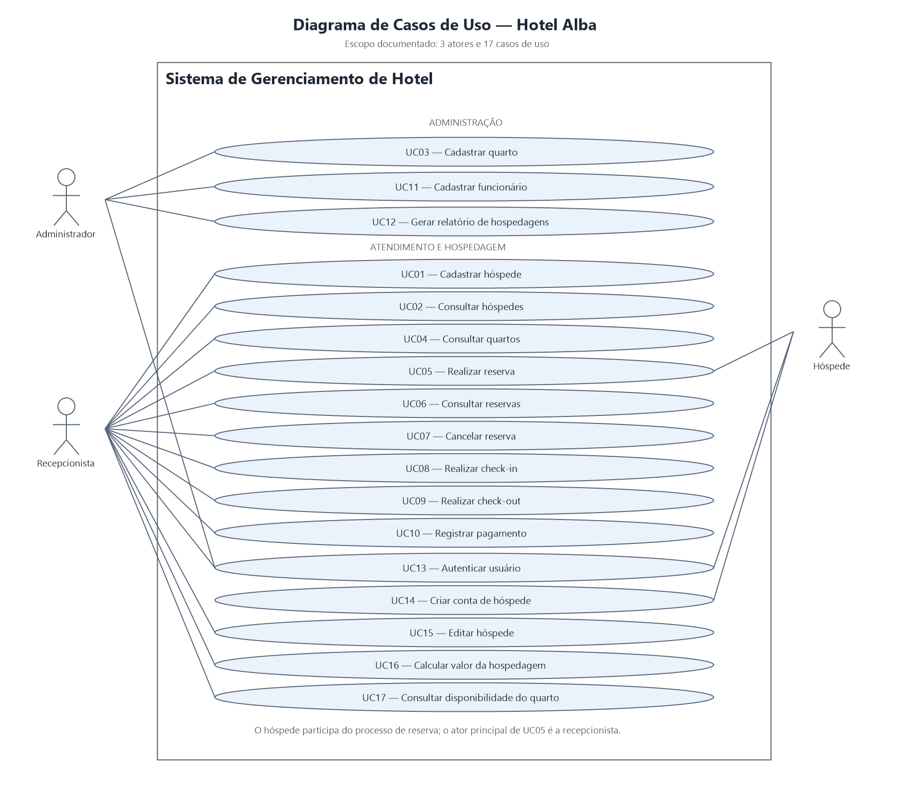

# Diagrama de Casos de Uso — Hotel Alba

O diagrama contém os três atores e os dezessete casos de uso documentados em [casos-de-uso.md](casos-de-uso.md). O arquivo-fonte editável é [diagrama-de-casos-de-uso.drawio](diagrama-de-casos-de-uso.drawio). Para gerar novamente o PNG após editar a fonte, execute `powershell -ExecutionPolicy Bypass -File docs/atualizar-diagrama.ps1`.
