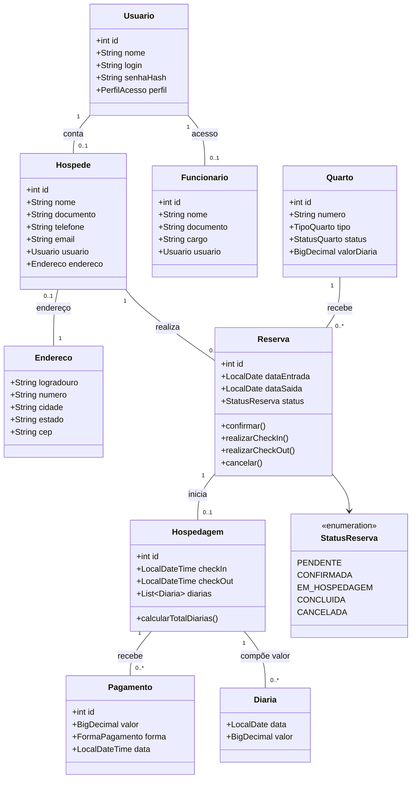

# Modelo de domínio — Hotel Alba

O diagrama abaixo corresponde às classes de domínio da aplicação Java. A entidade `Reserva` controla um ciclo de vida com cinco estados possíveis e valida as transições de confirmação, check-in, check-out e cancelamento.

As classes `TipoQuarto`, `StatusQuarto`, `PerfilAcesso` e `FormaPagamento` também estão implementadas como enumerações no pacote `br.com.hotel.domain`.
