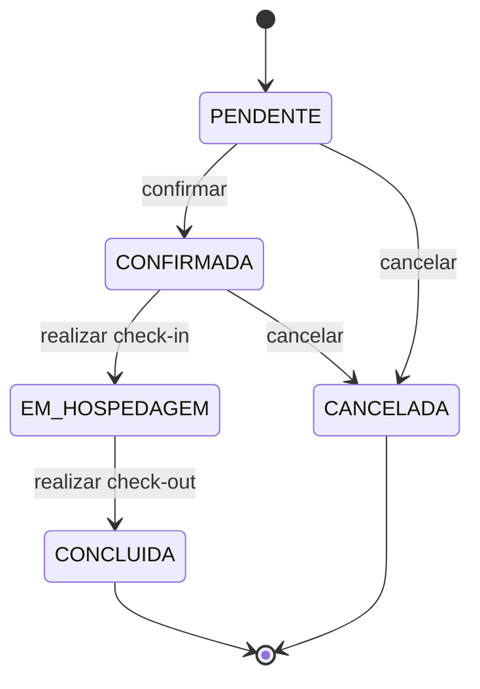

# Diagrama de estados — Reserva

O ciclo abaixo é implementado em `br.com.hotel.domain.Reserva` e `StatusReserva`. Cancelamento só é permitido enquanto a reserva está pendente ou confirmada; check-in e check-out só podem ocorrer na ordem indicada.

